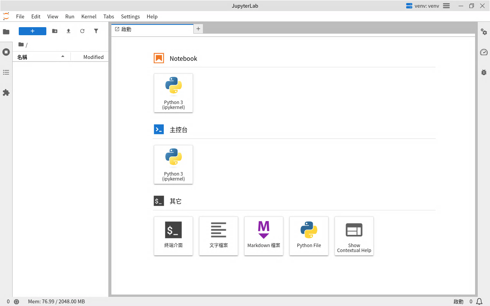

# rdp-jupyter 系統運作架構

適用映像檔：`ghcr.io/braveantony/rdp-jupyter:0.1`

本文件說明一次連線從用戶端到 kernel 的完整路徑、Pod 裡每個 process 的職責，以及帳號之間的安全邊界（威脅模型）。設計決策的理由見 [design/README.md](design/README.md)。

## 連線路徑

1. 使用者在 Windows 用「遠端桌面連線」（`mstsc`），或在 Mac 用 Windows App，以 **RDP** 連到叢集任一節點的 **NodePort `30391`**（Kubernetes 在每個節點上開放的固定埠號）。
2. NodePort 由 namespace `rdp-jupyter`（namespace 是 Kubernetes 用來分組資源的名稱）裡的 **Service `rdp-jupyter`** 開放，它把 30391 轉到 Pod 的 **3389** 埠。你連的節點不一定是 Pod 所在的節點，Kubernetes 會自動轉送過去。
3. 連線進入 **rdp-jupyter Pod**。在 xrdp 登入畫面輸入帳號密碼後，看到的就是全螢幕的 JupyterLab Desktop。

## Pod 內部

Pod 只有**一個 container `desktop`**。裡面的 process 分成兩批啟動：

- **container 啟動時**：由 `tini`（container 裡第一個啟動的小程式，負責啟動和回收其他 process）執行 `/opt/rdp-jupyter/entrypoint.sh`，它依序做這幾件事，最後啟動 xrdp 和 xrdp-sesman：
  1. 依帳號檔案建立登入帳號。
  2. 把**驗證、正規化後的設定值**（`KERNEL_MEMORY_LIMIT`、`KERNEL_THREADS`、`KERNEL_CULL_IDLE_TIMEOUT`、`DISCONNECTED_TIMEOUT`、`JUPYTER_LOCALE` 等共 6 個，例如 `JUPYTER_LOCALE` 會從 `zh-tw` 正規化成 `zh_TW`）寫到 `/run/rdp-jupyter/session.env`，給桌面的腳本讀取。寫進去的是這些處理過的值，不是 container 環境變數的原樣——sesman 用乾淨的環境啟動桌面，讀不到 container 原本的環境變數，所以才要透過這個檔案傳。
  3. 依這些值改寫 `sesman.ini`（`Policy`、`MaxSessions`、斷線逾時）。
  4. 產生 JupyterLab 的預設語系設定。
  5. 產生這個 Pod 專用的 TLS 憑證和 RSA 金鑰（還沒有時才產生；新建的 Pod 一定會用新產生的）。
- **使用者登入時**：由 xrdp-sesman 執行 `/etc/xrdp/startwm.sh`，開一個新桌面。

xrdp 或 xrdp-sesman 結束時，container 就會停止，由 Kubernetes 重啟。關掉 JupyterLab Desktop 只會讓那一個桌面登出，不影響 container。

另外有一個 **postStart hook**（`install-extra.sh`）和 entrypoint 同時開始：如果掛了 `requirements.txt` 的 ConfigMap，它會把額外套件裝進 `/opt/jupyter/extra`。hook 執行完之前 container 不會進入 Running、Pod 不會 Ready，所以透過一般 Service 路徑（NodePort）的連線要等 Pod Ready 後才能使用。它一律以 `exit 0` 結束，安裝失敗不會害 container 被殺，而是在桌面跳出通知。

| 元件 | 職責 |
|---|---|
| **xrdp** `:3389`／**xrdp-sesman** | RDP 入口。xrdp 接收連線並顯示登入畫面；xrdp-sesman 用 PAM（Linux 的帳號密碼驗證機制）驗證帳號。`Policy=Default`：同一帳號斷線後重新連線會接回原本的桌面。同時存在的桌面上限是 `MAX_SESSIONS`（預設 3，包含斷線中的桌面） |
| **Xorg 桌面 × N** | 每個登入的帳號一個桌面（獨立的 Xorg 畫面伺服器）。桌面裡跑 openbox（視窗管理程式，讓視窗全螢幕、沒有邊框）和**全螢幕的 JupyterLab Desktop** |
| **JupyterLab Desktop** | `/opt/JupyterLab` 的 Electron 應用程式，由 `startwm.sh` 以 `--no-sandbox --disable-gpu` 啟動。`app.asar` 已套用 token patch（見下文） |
| **Jupyter server 與 kernel** | 每個桌面各一組，由 JupyterLab Desktop 啟動，**只監聽 `127.0.0.1`**（本機迴路位址，只有同一個 Pod 內連得到，叢集別處連不進來）。kernel 就是跑 notebook 程式碼的 Python process |
| **基本 venv** | `/opt/jupyter/venv`，root 擁有、使用者唯讀。內含 jupyterlab、ipykernel、pandas、matplotlib、繁中語言包、jupyter-resource-usage |
| **額外套件** | `/opt/jupyter/extra/current`，postStart 依 ConfigMap 安裝，透過 `.pth` 接進 venv |
| **使用者套件** | `~/.local`，使用者自己 `%pip install --user`，只影響自己；stateful 模式會保留 |

### 每個桌面怎麼啟動與清除

`startwm.sh` 以登入帳號的身分執行：

1. 建立這個桌面專用的目錄 `/tmp/sess/<顯示編號>.<UID>/`（權限 `0700`）。目錄名稱包含顯示編號（display）和 UID（Linux 的使用者編號）。目錄已經存在而且不屬於自己時（例如被別的帳號先建立），就拒絕啟動。
2. 在這個目錄下準備桌面專用的環境：
   - `xdg/` 是 `XDG_CONFIG_HOME`；JupyterLab Desktop 的 `userData` 就在它底下的 `xdg/jupyterlab-desktop/`。`Policy=Default` 下同一帳號只會有一個桌面，這個隔離是保險：萬一同一帳號出現兩個桌面，JupyterLab Desktop 的 single-instance 鎖不會讓第二個桌面一啟動就結束。
   - `run/` 是 `XDG_RUNTIME_DIR`。
   - `~/.jupyter` 設成 `JLAB_DESKTOP_CONFIG_DIR`：JupyterLab 的使用者設定（主題、快捷鍵等）放在這裡，在同一帳號的桌面之間共用，stateful 模式會保留。
3. 寫出這個桌面的 `settings.json`（見下表），再啟動 openbox 和 JupyterLab Desktop。
4. JupyterLab Desktop 啟動 Jupyter server：載入 venv 的 `activate`，裡面會套用記憶體上限和執行緒數（見[記憶體與長時間運算](#記憶體與長時間運算)）；token 透過 `JUPYTER_TOKEN` 環境變數傳。
5. 使用者關閉 JupyterLab Desktop，桌面就結束；或斷線逾時後，由 **xorgxrdp** 清掉這個桌面的 Xorg，JupyterLab Desktop 失去畫面伺服器跟著結束（不是 sesman 送 SIGTERM）。兩種情況下，`startwm.sh` 的清理流程都會先送 TERM 給整個 JupyterLab Desktop 的 process group（讓它關掉 server 和 kernel），再刪除整個 `/tmp/sess/<顯示編號>.<UID>/`，桌面隨即結束。

`settings.json` 的主要欄位：

| 欄位 | 值 |
|---|---|
| `pythonPath` | `/opt/jupyter/venv/bin/python` |
| `startupMode` | `new-local-session` |
| `checkForUpdatesAutomatically` 等更新與新聞相關欄位 | `false`（升級映像檔是管理者的事，使用者不必被提示） |
| `defaultWorkingDirectory` | 使用者的家目錄 |
| `serverArgs` | `--MappingKernelManager.cull_idle_timeout=<KERNEL_CULL_IDLE_TIMEOUT> --MappingKernelManager.cull_interval=300 --ResourceUseDisplay.mem_limit=<換算成 bytes 的 KERNEL_MEMORY_LIMIT>` |

### 語系

entrypoint 依 `JUPYTER_LOCALE` 產生 `/opt/jupyter/venv/share/jupyter/lab/settings/overrides.json`，把 JupyterLab 的介面語言預設成 `zh_TW` 或 `en`。這只是預設值，使用者在選單裡改過語言時以使用者的設定為準。

## 記憶體與長時間運算

- **每個 kernel 的記憶體上限**：建置時在 venv 的 `bin/activate` 最後加一行 source `server-env.sh`。launch 腳本會載入 `activate`，所以它設定的 `ulimit -S -H -d`（`RLIMIT_DATA`）會由 Jupyter server 和之後的 kernel、Terminal 繼承，使用者不能調高。大小由 `KERNEL_MEMORY_LIMIT` 決定（預設 `2Gi`）。超過上限的配置通常會在那一格跳 `MemoryError`、kernel 多半能存活，但不保證所有情況下 kernel 都不中斷，仍應定期存檔。
- **執行緒數**：同一個檔案設定 `OPENBLAS_NUM_THREADS`、`OMP_NUM_THREADS`、`MKL_NUM_THREADS`，由 `KERNEL_THREADS` 決定（預設 `2`）。
- **用量顯示**：`jupyter-resource-usage` 在 JupyterLab 狀態列顯示目前的記憶體用量和上限。

- **閒置回收**：`KERNEL_CULL_IDLE_TIMEOUT`（預設 `3600` 秒）之後回收閒置的 kernel；正在執行的不回收。
- **已知限制**：上限是每個 process 各自計算，同一個人開 N 個 kernel 最多可用 N × `KERNEL_MEMORY_LIMIT`。所有桌面共用同一個 Pod 的 `limits.memory`，加起來超過時整個 Pod 會被 OOM（記憶體用盡時，系統強制終止程式）殺掉（tk8s 的 cgroup v2 設定下，container 一 OOM 整個 Pod 都被殺）。詳見 [README 的安全警告](../README.md#安全警告)。

## 其他連線與儲存

- **資料存取**：kernel 在 Pod 裡，用 `<service>.<namespace>` 直接連叢集內的 PostgreSQL、MinIO／S3 等服務，不必另外對外開放。範例見 [data-access.md](data-access.md)。
- **帳號**：Secret `rdp-jupyter-users-<雜湊>`（Secret 是 Kubernetes 存放密碼等敏感資料的物件）以唯讀方式掛載到 `/etc/rdp-jupyter/users`，每行一個 `帳號:密碼`。container 啟動時 `entrypoint.sh` 依這個檔案建立登入帳號（UID 從 1000 起），xrdp-sesman 用這些帳號驗證登入。每個帳號的 home 權限是 `0700`。
- **額外套件**：ConfigMap `rdp-jupyter-requirements`（key `requirements.txt`）設成 `optional: true`，掛了才裝。
- **儲存**：`/home` 和 `/opt/jupyter/extra` 依 overlay 是 emptyDir（Pod 刪掉就消失）或 PVC（保留）。`/dev/shm`（共用記憶體）掛載為記憶體型的 emptyDir，大小上限 1 GiB，因為用預設的 64 MiB 時，kernel 載入中文字型或大陣列會崩潰。

## 安全邊界

- 叢集外只有 NodePort `30391`（RDP）一個入口。
- 登入後就在叢集內部網路裡：notebook 的 kernel 連得到叢集內的 Service 和 Pod（叢集沒有設定 NetworkPolicy 這類限制時）。所以**預設帳密等於叢集內部網路的存取權**，只適合隔離的實驗環境。
- xrdp 與 xrdp-sesman 以 root 執行（Debian trixie 的 xrdp 0.10.1 不支援降權；sesman 本來就需要 root 才能驗證帳號、切換成登入者）；Xorg、openbox、JupyterLab Desktop、Jupyter server 和 kernel 都以登入者的身分執行，container 設了 `allowPrivilegeEscalation: false`（禁止 process 取得比原本更高的權限）。
- TLS 憑證與 RSA 金鑰在 container 啟動時、還不存在時才產生，所以每個新建的 Pod 都有自己的一組，不寫進映像檔；密碼來自 Secret，也不寫進映像檔。
- **不開 RDP 檔案傳輸**：`xrdp.ini` 關掉 drive redirection（`rdpdr=false`），`sesman.ini` 關掉 FUSE 掛載（`EnableFuseMount=false`）。原因見下方威脅模型。文字剪貼簿不受影響。

### 威脅模型

威脅模型的邊界是 **UID**：同一個 Pod 裡，帳號 A 想以帳號 B 的身分執行程式，或讀 B 的資料。對策如下。

| 攻擊途徑 | 對策 |
|---|---|
| 從 `/proc/*/cmdline` 讀到 B 的 Jupyter server token | **token 不放命令列**：建置時改 `app.asar`，token 改用 `JUPYTER_TOKEN` 環境變數傳（見下方 token patch）。環境變數只有同 UID 讀得到 |
| 讀 B 的 `/proc/<pid>/environ`、ptrace（偵錯用的 process 附掛）B 的 process | Linux 預設只有同 UID 能做；再加上 `allowPrivilegeEscalation: false` |
| 連 B 的 Jupyter server（`127.0.0.1`） | 沒有 token 就無法通過認證，`/api/kernels` 回 403 |
| 連 B 的 kernel ZMQ 埠（kernel 與前端之間傳訊息的網路埠） | connection file 權限 `0600`；ZMQ 訊息有 HMAC 簽章（用共用金鑰算出的驗證碼，證明訊息沒被竄改），未簽章的請求會被拒絕 |
| 讀 B 的家目錄、桌面目錄、kernel runtime 目錄 | 家目錄、`/tmp/sess/<…>`、runtime 目錄都是 `0700` |
| 改寫共用的 venv 或額外套件目錄 | root 擁有、使用者唯讀，寫入失敗 |
| 透過 JupyterLab 的 Terminal 拿到 shell | 不算漏洞：A 本來就能在自己的桌面開 shell，權限只有 A 自己 |

這些對策由 `test/image/isolation.test.sh` 以 A 的身分實際驗證（驗收標準 A4）。

**為什麼不開 RDP 檔案傳輸（D9）**：RDP 的磁碟轉送要用 FUSE，Pod 必須有 `/dev/fuse` 並授予 `SYS_ADMIN` capability，這會打破上面以 UID 為界的隔離，也違反 Pod Security 的 baseline。所以 drive redirection 和 FUSE 都關掉，資料改走叢集服務或 Git（見 [data-access.md](data-access.md)）。

**Electron sandbox**：tk8s 的 RuntimeDefault seccomp（限制 container 能用哪些系統呼叫的機制）擋掉 Chromium 的 namespace sandbox，所以 JupyterLab Desktop 以 `--no-sandbox` 啟動。這不影響上面的帳號隔離：renderer（Chromium 裡負責畫面的子 process）被攻破後拿到的只是使用者自己的 UID，而使用者本來就能透過 kernel 以這個 UID 執行任意程式。代價是惡意的 notebook 輸出若攻破 renderer，可以用該使用者的權限做事，等同使用者自己執行程式。完整理由見 [design/README.md](design/README.md) 的決策 D5 一節。

### token patch（D5）

JupyterLab Desktop 原本把 server token 放在命令列（`--ServerApp.token=...`），其他帳號能從 `/proc/*/cmdline` 讀到。建置時用 `@electron/asar` 解開 `app.asar`，改兩個地方再打包回去：

1. `build/out/main/config/settings.js`：拿掉 `--ServerApp.token="{token}"` 這個參數。
2. `build/out/main/server.js`：在啟動 server 的環境裡加上 `JUPYTER_TOKEN`（Jupyter Server 2.20 會讀這個環境變數）。

patch 由 `images/rdp-jupyter/patches/token-env.sh` 執行，每處修改都先確認原文剛好出現一次，否則讓建置失敗。升級上游時 patch 失效會在建置階段就被擋下，不會默默產生沒有防護的映像檔。
