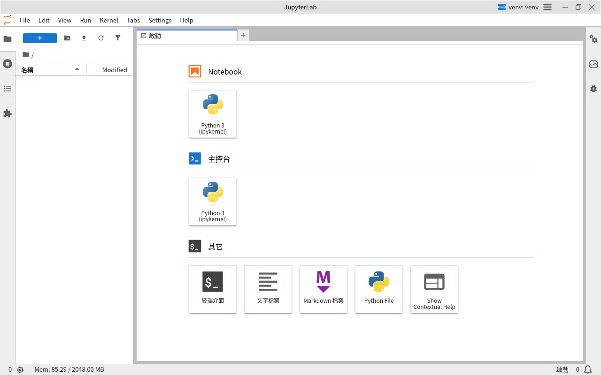

# JupyterLab 遠端桌面使用手冊

適用映像檔：`ghcr.io/braveantony/rdp-jupyter:0.1`。安裝方式見 [README](../README.md#快速開始)。

用 Windows 內建的「遠端桌面連線」登入後，畫面上只有一個全螢幕的 JupyterLab Desktop。開一個 notebook 就能寫 Python，kernel 在叢集的 Pod 裡執行，可以直接連叢集內的資料庫和物件儲存做分析。

## 1. 連線與登入

| 項目 | 值 |
|---|---|
| 電腦 | 管理者給你的位址，例如 `192.168.11.64:3391` |
| 帳號 | 管理者發給你的帳號（預設是 `bigred`） |
| 密碼 | 管理者發給你的密碼（預設是 `bigred`） |

1. 按 `Win+R`，輸入 `mstsc`，按 Enter，開啟「遠端桌面連線」。
2. 電腦欄位填上面的位址（含 `:` 和埠號），按「連線」。
3. 出現憑證警告（「無法驗證此遠端電腦的身分識別」）時，按「是」。每個 Pod 使用自己產生的憑證，這是正常的。
4. 畫面會出現 xrdp 的登入畫面：Session 保持 `Xorg`，填入帳號和密碼，按 OK。

## 2. 開 notebook

登入後會看到全螢幕的 JupyterLab Desktop，中間是啟動頁（Launcher）。

1. 在「Notebook」區按 **Python 3 (ipykernel)**，開一個新的 notebook。
2. 在儲存格（cell）裡寫 Python，按 `Shift+Enter` 執行。預裝了 pandas、matplotlib，直接 `import pandas as pd`、`import matplotlib.pyplot as plt` 就能用。
3. 左邊的檔案瀏覽器顯示你在 Pod 裡的家目錄（`/home/<帳號>`），notebook 預設存在這裡。按 `Ctrl+S` 存檔。



> stateless 模式下，Pod 重建（例如管理者改設定重新部署）就會清空家目錄，notebook 會消失。重要的 notebook 請用 Git 推出去，或請管理者改用 stateful 模式（見[安裝手冊](install.md)）。

## 3. 連叢集內的服務

kernel 在 Pod 裡，所以在 notebook 裡可以用 `<service>.<namespace>` 直接連叢集內的服務。例如用 pandas 查詢 PostgreSQL、讀寫 MinIO／S3，或用 Git 把 notebook 搬進搬出。完整範例和每個範例需要的套件，見[資料存取指南](data-access.md)。

> **不能從你自己的電腦直接拖檔案進來。** 遠端桌面的磁碟轉送已經關閉（原因見[資料存取指南](data-access.md)），資料一律透過叢集服務或 Git 進出。文字剪貼簿不受影響，可以照常複製貼上程式碼。

## 4. 裝額外套件

映像檔只預裝 pandas、matplotlib。需要其他套件時有兩種方式：

- **自己裝（只影響自己）**：在 notebook 的儲存格裡執行 `%pip install --user <套件>`，裝到自己的 `~/.local`。裝完重新啟動 kernel（選單 **Kernel → Restart Kernel**）再 import。stateful 模式下重開桌面還在，stateless 模式下 Pod 重建就要重裝。

  ```python
  %pip install --user plotly
  ```

- **請管理者裝（所有人共用）**：管理者把套件加進 `requirements.txt` 的 ConfigMap，Pod 啟動時就裝好，每個帳號都能用。做法見[安裝手冊](install.md#管理者提供額外-python-套件)。

## 5. 記憶體與長時間運算

- **每個 kernel 有記憶體上限**（預設 2 GiB，由管理者的 `KERNEL_MEMORY_LIMIT` 決定）。這個上限是**每個 kernel 各自**計算的，超過時通常那一格會跳 `MemoryError`、kernel 多半能繼續用，縮小資料再試即可；但這不是絕對保證，記憶體壓力大時 kernel 仍可能中斷，所以請定期存檔。
- **狀態列會顯示用量**：JupyterLab 視窗左下角的 `Mem: … / 2048.00 MB`，左邊是你這個桌面所有 kernel **加總**的記憶體用量，右邊（`2048.00 MB`）是單一 kernel 的上限。所以同時開好幾個 kernel 時，左邊的總量是有可能超過右邊那個數字的——右邊只是每個 kernel 各自的天花板，不是總量的上限。
- **閒置的 kernel 會自動回收**（預設閒置 1 小時後），釋放記憶體。正在執行的不會被回收。被回收後重新執行儲存格會啟動新的 kernel，但之前算出來的變數會不見，要從頭跑一次。
- **所有人共用同一個 Pod 的記憶體**：一個人開很多 kernel，或很多人同時跑大運算，加起來超過 Pod 上限時，整個 Pod 會被重啟，**所有人的桌面都會中斷、未存檔的內容會消失**。跑大運算前先存檔，用完的 notebook 記得關掉 kernel（檔案瀏覽器旁的「Running Terminals and Kernels」分頁可以關）。

## 6. 斷線與重新連線

- **斷線後可以接回原本的桌面**（前提是這個桌面還沒逾時被清掉、而且 Pod 沒有重建過）：網路斷掉，或不小心關掉遠端桌面視窗，重新用同一個帳號登入，就會回到原本的桌面，正在執行的 kernel 和算到一半的結果都還在。桌面預設保留 8 小時（由管理者的 `DISCONNECTED_TIMEOUT` 決定），逾時才清掉；Pod 重建（例如管理者改設定重新部署）後，所有桌面都會消失，登入就是全新的桌面。
- **同一個帳號不能同時開兩個桌面**：你在另一台電腦用同一個帳號登入時，會接回原本那個桌面，原本的連線隨即中斷。要兩個獨立的桌面，請用不同帳號。
- **主動結束**：關掉 JupyterLab Desktop 的視窗（右上角的關閉按鈕）就會登出並中斷遠端桌面。下次登入是全新的桌面。

## 7. 多人同時使用

- 每個帳號登入都有自己的桌面、自己的 kernel 和自己的家目錄，彼此看不到對方的 notebook。
- 同時最多 3 個桌面（所有帳號合計，由管理者的 `MAX_SESSIONS` 決定），超過時登入會失敗。**剛斷線但還沒逾時清掉的桌面也占一個名額**，所以如果有人斷線沒登出，名額會被占著直到逾時。

## 8. 使用時要知道的事

- **沒有中文輸入法**：遠端桌面裡不能打中文。在自己的電腦（例如記事本）打好，複製後在 JupyterLab 按 `Ctrl+V` 貼上。
- **介面語言**：預設繁體中文，管理者可以用 `JUPYTER_LOCALE` 切換英文。你也可以在 **Settings → Language** 自己改，改過之後以你的設定為準。
- **主題和快捷鍵等設定**會保留在 `~/.jupyter`，同一帳號的每個桌面共用；stateful 模式下 Pod 重建也還在。

## 9. 常見問題

| 看到的訊息或現象 | 原因 | 處理 |
|---|---|---|
| 憑證警告「無法驗證此遠端電腦的身分識別」 | Pod 使用自己產生的憑證 | 按「是」繼續 |
| `User does not exist, or could not be authenticated` | RDP 帳號或密碼錯誤 | 向管理者確認帳密 |
| 登入失敗、連不進去 | 已經有 3 個桌面在使用（含斷線未清的） | 等別人登出；斷線的桌面要等 `DISCONNECTED_TIMEOUT` 逾時才釋放 |
| 連上後畫面一片空白、JupyterLab 沒出現 | Pod 的 `/dev/shm` 太小，Electron 啟動時崩潰 | 請管理者確認部署有掛 1 GiB 的 `/dev/shm`（見 [architecture.md](architecture.md)） |
| 登入後桌面上跳出「額外套件安裝失敗」的視窗 | 管理者的 `requirements.txt` 裝不起來（套件名稱錯、連不到 PyPI 等）；這個通知在你登入進桌面時就會跳出 | 不影響你用預裝的套件；請管理者看 Pod log 修正 |
| 某一格跳 `MemoryError` | 這個 kernel 的記憶體到上限了 | 縮小資料、分批處理，或請管理者調高 `KERNEL_MEMORY_LIMIT` |
| 重新連線後 kernel 的變數不見了 | kernel 閒置被回收，或 Pod 被重啟過 | 從頭重新執行 notebook。若只是 kernel 被回收，已存檔的 `.ipynb` 還在，只是算出來的變數要重算；若是 Pod 被重建，stateless 模式連已存檔的 notebook 也會跟著家目錄一起消失（stateful 模式的 `/home` 才會保留），所以重要的 notebook 請隨時用 Git 推出去 |
| `%pip install --user` 裝好了卻 import 不到 | kernel 還是舊的 | 選單 **Kernel → Restart Kernel** 後再 import |
